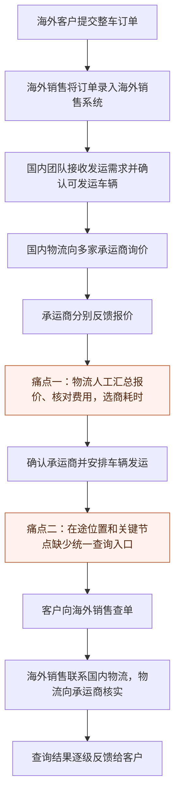

# 海外整车发运管理系统

> 项目管理作品集 · 模拟业务案例  
> > 混合式项目管理（hybrid approach)：整体按阶段和里程碑推进，功能开发与业务验证采用短周期迭代

## 项目背景
公司海外整车销售由海外市场接单、国内团队组织交付。海外销售已通过现有销售系统记录客户订单，国内团队需要根据订单要求选择承运商，将车辆运至客户指定地点。实际履约中，发运前，国内物流难以快速比较不同承运商的报价，选定承运方需要花费较多时间；发运后，车辆由外部承运商运输，国内团队难以及时掌握车辆位置，海外销售也就难以准确答复客户关于交付进度的询问。为缩短选商时间、让国内外团队能够查询在途进度，公司决定启动“海外整车发运数字化”项目。

## 业务流程与两大痛点

## 项目干系人

| 从属方 | 干系人 | 主要职责 |
| --- | --- | --- |
| 项目管理 | 项目经理（PM） | 制定计划，协调各方，跟踪进度和风险，组织验收与上线。 |
| 国内团队 | 制造团队 | 确认可发运车辆、备车时间和分批发运清单。 |
| 国内团队 | 物流团队 | 组织询价与比价，安排发运，跟踪运输节点并处理异常。 |
| 国内团队 | 国内销售团队 | 与海外销售核对订单和交付要求，将变更同步给制造和物流。 |WBS
| 国内团队 | 财务团队 | 确认币种、汇率和附加费等比价规则，复核报价结果。 |
| 国内团队 | IT 团队 | 开发比价与查单功能，对接销售系统和承运商系统，支持上线运行。 |
| 海外市场 | 海外销售团队 | 接收并录入客户订单，同步交付要求，跟进客户查单与反馈。 |
| 海外市场 | 海外客户 | 提交订单及交付要求，查询运输进度，确认收货。 |
| 外部合作方 | 承运商 | 提交报价、承运车辆，配合系统对接并回传运输节点。 |
> 目的：将任务拆解后分配给责任人

## WBS

[查看海外整车发运数字化项目 WBS 结构图（PDF）](./绘图一.pdf)
