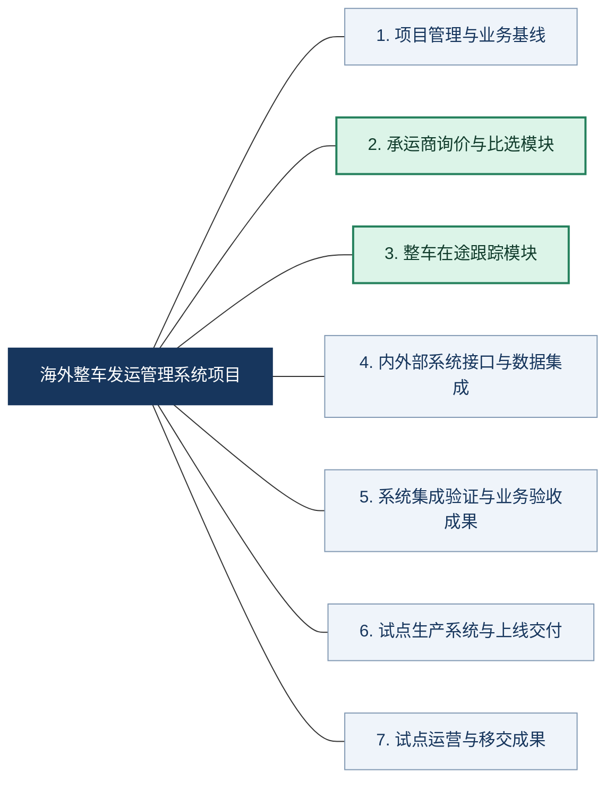
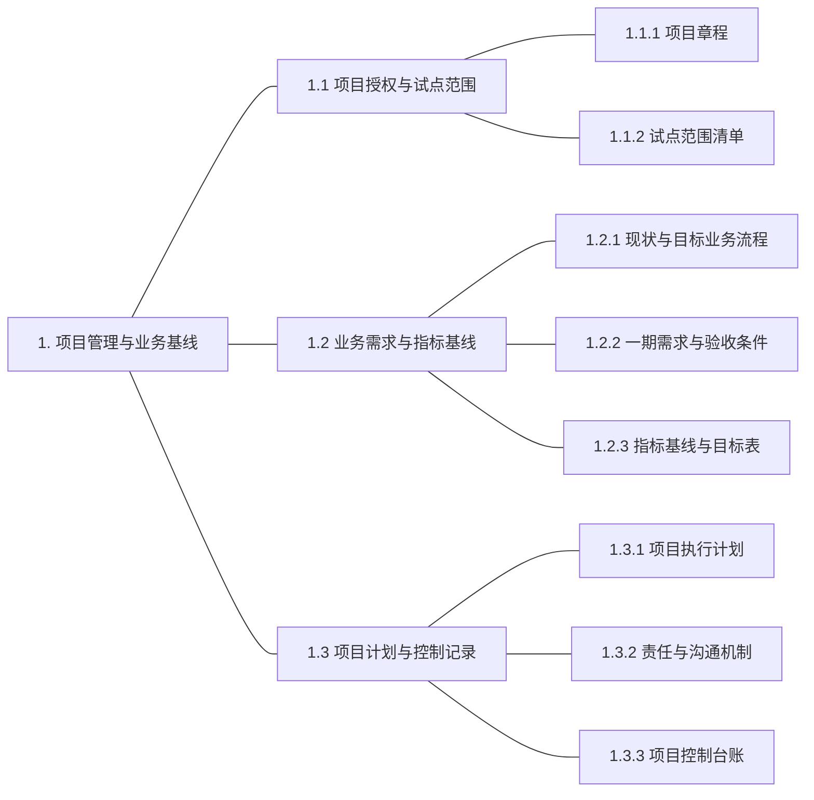
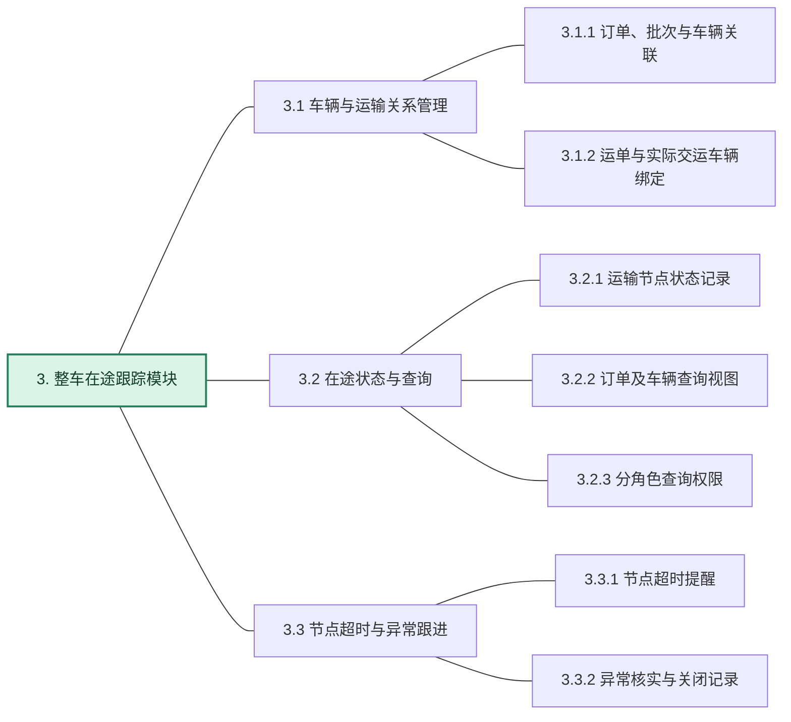
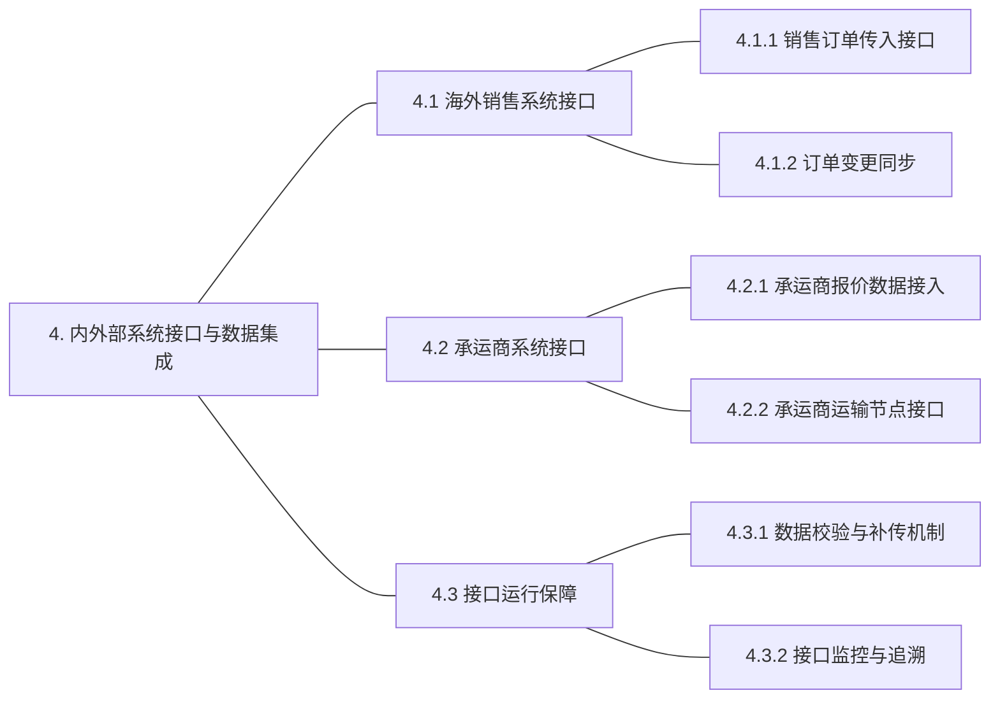
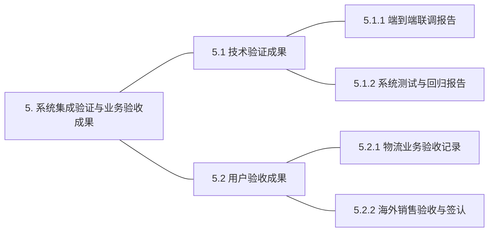
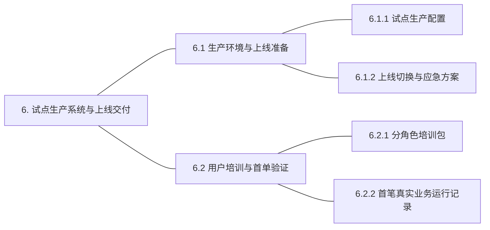
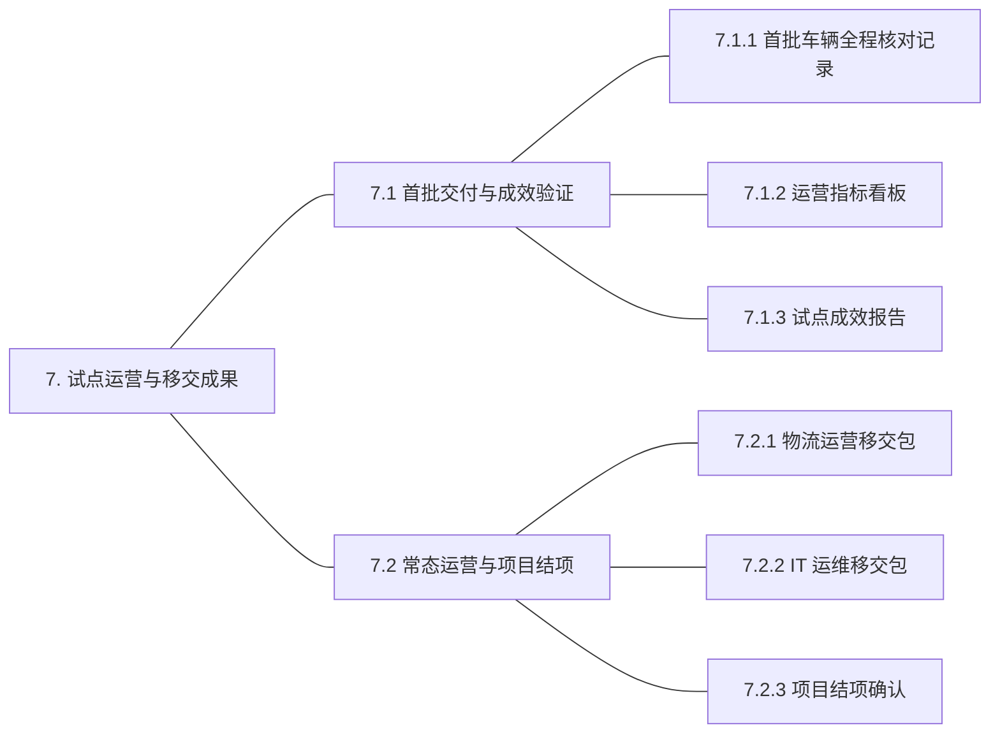

```mermaid
flowchart LR
    B2["2. 承运商询价与比选模块"]

    B2 --- A["2.1 统一询价与报价受理"]
    A --- A1["2.1.1 发运需求与询价单"]
    A --- A2["2.1.2 报价受理与修订功能"]

    B2 --- B["2.2 报价标准化与比价"]
    B --- B1a["2.2.1 费用映射与折算功能"]
    B --- B2a["2.2.2 可比性校验与差异提示"]
    B --- B3a["2.2.3 比价结果展示"]

    B2 --- C["2.3 选商审批与结果留存"]
    C --- C1["2.3.1 选商建议与授权审批"]
    C --- C2["2.3.2 选商记录与发运交接"]

    style B2 fill:#DCF4E8,stroke:#25815D,color:#123D2D,stroke-width:2px
```

# 交付范围与进度基准

> **项目性质**：模拟业务案例  
> **计划状态**：进度基准草案 v0.1，待项目评审确认  
> **拟定启动日期**：2026 年 12 月 1 日  
> **一期范围**：承运商询报价与选商、整车在途跟踪、客户查单，以及海外销售系统、ERP 和承运商 TMS 的必要数据对接。

## 一、项目里程碑与通过条件

以下采用相对排期。W1 表示项目启动后的第一个工作周。实际日期在试点线路、承运商联调窗口和节假日安排确认后锁定。

| 里程碑 | 计划节点 | 通过条件 | 验收依据 |
| --- | --- | --- | --- |
| M1 需求基线确认 | W4 末 | 国内物流、销售、制造、财务、IT 与海外市场代表确认一期范围；报价比较口径、分批发运规则、必传运输节点及超时责任人均已明确。 | 经评审的需求规格、目标流程图、需求决策记录 |
| M2 承运商接口联调通过 | W7 末 | 使用试点样单，将销售订单、发运批次、VIN 和运单正确关联；承运商回传一个有效节点后，仅更新对应批次；重复回传不会新增重复事件，异常记录可追踪。 | 字段映射表、联调记录、异常场景验证结果 |
| M3 用户验收通过 | W18 末 | 物流完成询价与选商，海外销售或客户能查询分批状态；报价缺项、节点超时和查询权限均已验证；阻断上线的缺陷已关闭，业务负责人确认验收结果。 | UAT 用例及结果、缺陷记录、验收确认单 |
| M4 试点正式上线 | W19 末 | 已明确试点线路、承运商和订单范围；生产环境完成首票验证，询价可发出、运单可关联、查询权限正确；值守、异常处理和回退负责人已到位。 | 上线检查单、首票验证记录、运营交接清单 |
| M5 运营复盘与推广决策 | W20 首次复盘；最终日期按运输周期确认 | 核对询价耗时、节点回传及时率和查单工单；记录未达标原因。根据样本量与运输周期，由业务负责人决定扩大试点、继续观察或整改。 | 试点运营报告、遗留问题清单、推广决策记录 |

**验收边界**：M2 验证接口和数据关联，M3 验证完整业务流程，M4 验证生产环境可用。若 W20 尚无足够订单完成运输，首次复盘只报告已观测结果，签收和业务效果保留到后续复盘。

## 二、交付顺序与依赖关系

| 工作 | 计划窗口 | 前置条件及安排理由 |
| --- | --- | --- |
| 立项、现状调研、需求确认 | W1–W4 | 从历史订单还原询价与查单过程；同步取得承运商样例数据和联调联系人，尽早暴露外部依赖。 |
| 接口适配与首轮联调 | W5–W7 | M1 通过并取得接口样例后实施。优先跑通“一张订单、一批车辆、一条运输事件”，通过 M2。 |
| 智能比价模块开发 | W5–W8 | 依赖已确认的报价字段、费用口径和选商规则，可与接口联调并行推进。 |
| 在途跟踪与客户查单开发 | W5–W10 | 前期使用样例事件开发页面和状态逻辑；M2 通过后接入真实联调数据，验证分批展示。 |
| 测试设计与系统集成测试（SIT） | 用例设计 W5–W7；集中执行 W11–W14 | 用例设计随开发启动。集中测试前，报价、订单关联和在途查询模块须已交付测试环境。 |
| 用户验收测试（UAT）及修复 | W15–W18 | SIT 达到退出条件后，由业务人员按实际角色操作；预留缺陷修复与回归测试时间。 |
| 试点上线与运营观察 | W19 起 | M3 通过后启动生产切换。试点期间持续跟踪真实订单，按 M5 条件决定是否推广。 |

**重点依赖**：承运商样例数据和联调窗口影响 M2；M2 延误会压缩在途查询的真实数据验证时间。发生延期时，项目经理需分别评估比价模块和在途模块的影响，并提交调整方案。

## 三、工作分解结构（WBS）

### 1.0 项目管理与控制

- **1.1 项目章程与范围说明书**
- **1.2 项目管理计划**
  - 1.2.1 进度基准
  - 1.2.2 成本基准
  - 1.2.3 沟通与干系人参与计划
- **1.3 项目监控记录与报告**
  - 1.3.1 项目绩效报告与挣值分析（成本数据具备后开展）
  - 1.3.2 变更请求日志
  - 1.3.3 风险登记册

### 2.0 业务需求与流程重构

- **2.1 发运业务流程文档**
  - 2.1.1 现状流程图（As-Is）
  - 2.1.2 目标流程图（To-Be）
- **2.2 需求规格说明书**
  - 2.2.1 功能需求矩阵
  - 2.2.2 非功能需求说明
- **2.3 跨组织协同规则**
  - 2.3.1 承运商绩效考核指标及统计口径
  - 2.3.2 异常数据人工处理规程

### 3.0 核心系统交付物

- **3.1 智能比价模块**
  - 3.1.1 承运商在线报价页面
  - 3.1.2 自动比价与排序引擎
  - 3.1.3 电子定标协议生成组件
- **3.2 在途可视化模块**
  - 3.2.1 关键运输节点数据采集服务
  - 3.2.2 客户自助查单看板
- **3.3 数据集成中间件**
  - 3.3.1 ERP 订单数据接口及海外销售订单关联
  - 3.3.2 承运商 TMS 数据映射适配器

### 4.0 质量验证与测试资产

- **4.1 测试计划与用例**
  - 4.1.1 系统集成测试用例（SIT）
  - 4.1.2 用户验收测试用例（UAT）
- **4.2 测试与验收记录**
  - 4.2.1 缺陷跟踪与修复记录
  - 4.2.2 性能与压力测试报告
  - 4.2.3 用户验收测试签字确认书

### 5.0 部署与运营闭环

- **5.1 系统上线交付物**
  - 5.1.1 生产环境系统镜像与部署记录
  - 5.1.2 用户操作手册与培训材料
- **5.2 业务指标验收报告**
  - 5.2.1 询价周期与 4 小时内定标达标率分析
  - 5.2.2 运输节点数据回传及时率分析
  - 5.2.3 客户查单工单量及每百票工单数分析
- **5.3 项目收尾文件**
  - 5.3.1 经验教训登记册
  - 5.3.2 项目最终验收单

## 项目总览

## 工作包明细

<strong>1. 项目管理与业务基线</strong>

<strong>2. 承运商询价与比选模块</strong>

<strong>3. 整车在途跟踪模块</strong>

<strong>4. 内外部系统接口与数据集成</strong>

<strong>5. 系统集成验证与业务验收成果</strong>

<strong>6. 试点生产系统与上线交付</strong>

<strong>7. 试点运营与移交成果</strong>

## 四、进度跟踪与变更

- **工作包跟踪**：GitHub Issue 关联 WBS 编号和里程碑，记录负责人、计划完成时间、当前预测、阻塞原因和验收证据。
- **每周检查**：对照基准查看哪些工作预计延误、影响哪个里程碑、需要谁在什么时间前作出决定。
- **完成判定**：开发提交后进入“待验证”；测试记录或业务确认满足通过条件后，再将对应事项标记为完成。
- **基准变更**：当范围或外部依赖导致里程碑需要调整时，保留原计划，记录变更原因、影响、批准人和新版本。

**进度判定示例**：试点订单有 10 辆车，首批 6 辆发运。若承运商回传“已离港”后，系统将全部 10 辆都更新为已离港，则 M2 仍为“未通过”。即使接口已连通，也须修正批次映射，重新验证“6 辆已离港、4 辆待发运”后才能关闭联调任务。
