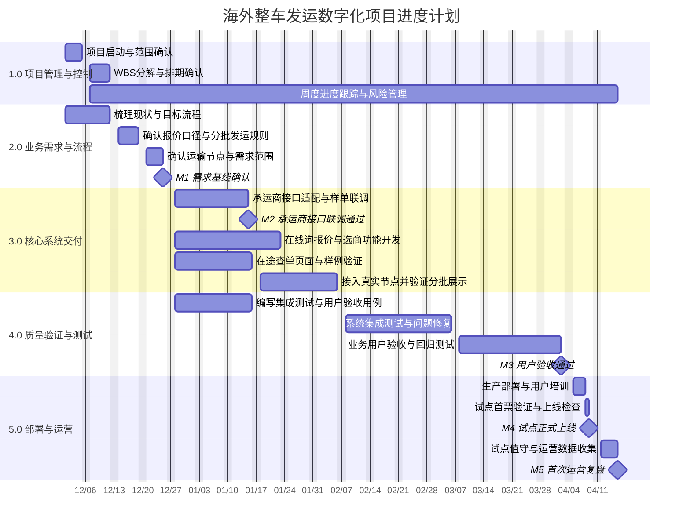

# 海外整车发运数字化项目｜进度计划

> 模拟项目排期，拟于 2026 年 12 月 1 日启动。W1 为启动当周，W20 为首次运营复盘周。计划按周一至周五安排，暂未调整节假日及承运商实际联调窗口。

## 里程碑与通过条件

| 里程碑 | 计划时间 | 判断依据 |
| --- | --- | --- |
| M1 需求基线确认 | W4 · 12 月 25 日 | 物流、财务及相关团队确认报价比较口径、分批发运规则、必传节点和一期范围。 |
| M2 承运商接口联调通过 | W7 · 1 月 15 日 | 用试点样单验证承运商回传的节点能关联到正确运单，仅更新本批车辆。 |
| M3 用户验收通过 | W18 · 4 月 2 日 | 业务人员走通询价、选商和分批查单场景，影响上线的问题已修复并复测。 |
| M4 试点正式上线 | W19 · 4 月 9 日 | 生产环境首票验证通过，物流、IT 和承运商明确上线后的问题对接人。 |
| M5 首次运营复盘 | W20 · 4 月 16 日 | 汇总已发生的询价耗时、节点回传及查单情况。对尚未完成运输的订单，继续跟踪至签收。 |

## 排期依据

- **需求先确认**：先统一报价口径、车辆分批规则和运输节点，再安排正式开发，避免各团队按不同理解实施。
- **开发可并行**：比价功能依赖报价规则；查单页面前期可以使用样例数据开发。承运商接口联调通过后，再用真实回传数据验证分批展示。
- **上线有条件**：项目经理根据 M3 的实际验收结果确认试点窗口。若关键场景未通过，应更新上线预测日期，并保留原计划供对照。
- **运营持续跟踪**：W20 只做首次复盘。待积累足够试点订单后，再评估询价周期、节点及时率和查单工单量是否达到目标。
