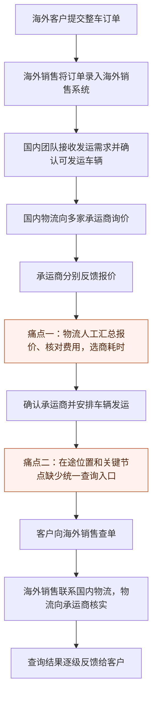
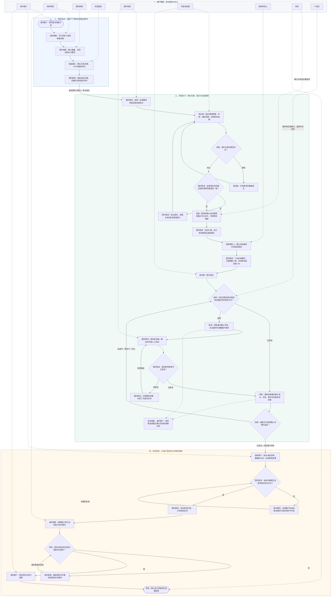

# Oversea shipping PM
> 作为一个销售经理，我拿到这个项目的初期首先会做两件事：
> > 梳理业务流程
> > 将整个业务流程中的干系人及他们的主要工作列出

海外销售收到客户订单后，将订单录入海外销售系统，由国内团队组织车辆发运至客户指定目的地。本项目聚焦两个环节：发运前的承运商比价，以及发运后的在途跟踪。

## 一、现状流程（As-Is）

## 二、目标流程（To-Be）

